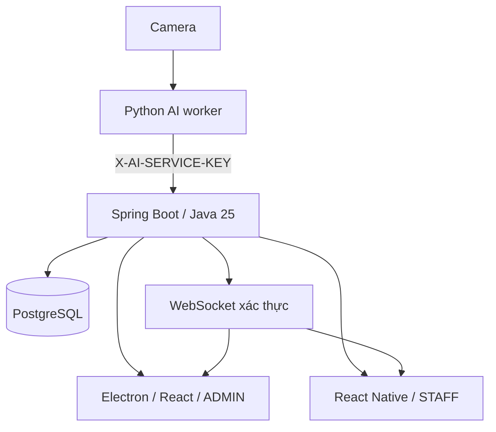

# Pool Safety Monitoring

Hướng dẫn chạy local, reset dữ liệu và tài khoản test: [docs/local-testing.md](docs/local-testing.md).

Chọn video trên máy và mô hình AI riêng cho từng camera (YOLO26n, checkpoint YOLO hoặc INO/ConvLSTM): [docs/camera-ai.md](docs/camera-ai.md).

Hệ thống giám sát an toàn **một hồ bơi**: backend Spring Boot, PostgreSQL, ứng dụng quản trị Windows bằng Electron và ứng dụng cứu hộ React Native. AI worker Python xử lý nguồn video và mô hình riêng của từng camera, gửi detection vào API backend.

Installer Windows và APK Android đã được tạo trong workspace. Xem [báo cáo build và kiểm thử](docs/validation.md) để biết vị trí artifact, các kiểm thử đã đạt và phạm vi kiểm thử Android còn lại.



## Cấu trúc và công nghệ

| Thư mục | Nội dung |
| --- | --- |
| `backend/` | Java 25, Spring Boot 3.5, Maven, Security, JPA, Validation, BCrypt, JWT/Nimbus, Flyway, OpenAPI, WebSocket |
| `desktop/` | Electron, React, TypeScript, Vite, Router, Zustand, Axios, Lucide, HLS.js, NSIS installer |
| `mobile/` | React Native 0.88, **Expo SDK 58**, React Navigation, Zustand, Axios, SecureStore, Expo Video |
| `shared/` | Types, API client, refresh rotation, realtime reconnect, incident action rules, theme |
| `ai/` | Worker nhận diện riêng từng camera: YOLO26n, YOLO tùy chỉnh và bộ nạp INO/ConvLSTM tham khảo |
| `scripts/` | Khởi động backend, tạo env, giả lập AI và tạo Postman collection |
| `docs/` | Giao thức realtime, kiểm thử và Postman collection |

Mobile chọn Expo để hỗ trợ Android/iOS, secure storage và video native. Đây là ứng dụng React Native thực, không phải WebView. Native project được sinh bằng `expo prebuild`; cấu hình nguồn nằm trong `app.json`, `app.config.js` và `eas.json`.

## Yêu cầu

- JDK **25**, Maven 3.9+ cho backend.
- Node.js 22.13+, 24.3+ hoặc 26+ và npm 10+. Launcher Mobile tự dùng Node 24 local trong `.tools/node24` nếu Node hệ thống không tương thích SDK 58.
- PostgreSQL 17 hoặc Docker Desktop với Compose.
- Windows cho installer Desktop. Android Studio/SDK và JDK 17 hoặc 21 cho native Android; JDK Android tách biệt với JDK 25 backend.
- Android emulator hoặc điện thoại; Expo Go hỗ trợ SDK tương ứng hoặc development build.

## Thiết lập lần đầu

PowerShell ở thư mục gốc:

```powershell
powershell -ExecutionPolicy Bypass -File scripts/init-env.ps1
npm install
Copy-Item desktop/.env.example desktop/.env
Copy-Item mobile/.env.example mobile/.env
```

Script tạo `.env` với JWT/AI/database secrets ngẫu nhiên. Nếu cấu hình thủ công, sao chép `.env.example` thành `.env` và thay mọi placeholder. JWT secret ít nhất 32 bytes; AI key ít nhất 24 ký tự; password 10–72 ký tự và tối đa 72 UTF-8 bytes (giới hạn BCrypt).

`.env` không được commit. Backend Java không tự đọc dotenv; script PowerShell nạp biến môi trường, còn Docker Compose tự đọc `.env`.

## Chạy PostgreSQL và backend

Chạy toàn bộ backend và DB bằng Docker:

```powershell
docker compose up --build -d
docker compose logs -f backend
```

Hoặc chỉ chạy DB rồi backend Java local:

```powershell
docker compose up -d postgres
powershell -ExecutionPolicy Bypass -File scripts/start-backend.ps1
```

Windows chưa có Docker/PostgreSQL có thể dùng launcher phát triển:

```powershell
powershell -ExecutionPolicy Bypass -File scripts/start-backend.ps1 -EmbeddedPostgres
```

Launcher dùng **PostgreSQL thật**, tải binary qua dependency kiểm thử, lưu dữ liệu tại `.runtime/postgres`, cổng `5433`, chỉ dùng cho phát triển local. Không dùng cấu hình trust authentication này trong production. Ctrl+C dừng backend và database. Hai cách launcher không chạy đồng thời trên cổng 8080.

Backend: `http://localhost:8080`. Health: `/actuator/health`. Swagger: `/swagger-ui`. OpenAPI JSON: `/api-docs`.

Flyway tạo schema; Hibernate luôn `ddl-auto=validate`. Không cần chạy SQL thủ công. Dev profile thêm migration V9 và seeder idempotent. Với `DEV_SAMPLE_DATA=false`, chỉ tạo `admin` và `staff1`, không tạo camera/sự cố mẫu. Với `DEV_SAMPLE_DATA=true`, tạo 1 ADMIN, 3 STAFF, 6 camera, 10 detection/incident, lịch sử và thông báo. Camera mẫu không giả lập video.

## Đăng nhập phát triển

Chỉ khi dùng `scripts/init-env.ps1` và profile `dev`:

| Ứng dụng | Username | Password phát triển |
| --- | --- | --- |
| Desktop | `admin` | `PoolSafetyDev!2026` |
| Mobile | `staff1` (thêm `staff2`, `staff3` nếu `DEV_SAMPLE_DATA=true`) | `PoolSafetyDev!2026` |

Nếu đổi `DEV_PASSWORD`, password mới chỉ áp dụng khi tạo user chưa tồn tại; không ghi đè mật khẩu user có sẵn. Đây là tài khoản **development only**.

Production: bỏ profile `dev`, dùng secrets riêng, DB mới và đặt `BOOTSTRAP_ADMIN_PASSWORD` cho lần khởi động đầu tiên để tạo admin. Gỡ biến bootstrap sau khi tạo tài khoản. Không mang DB seed phát triển vào production.

## Chạy Desktop

```powershell
cd desktop
npm run dev
```

Lệnh mở cửa sổ Electron thật cùng Vite. ADMIN đăng nhập; STAFF dùng Mobile (phiên STAFF đã lưu bị thu hồi khi mở Desktop). Có Dashboard, Live Monitor (click camera mở trang chi tiết, nút fullscreen), danh sách/detail sự cố với action ngay trên bảng, camera/user management (lọc, reset mật khẩu, xác nhận trước khi disable), Reports (thời gian phản hồi/xử lý), thông báo và Settings/audit history có lọc.

Panel cảnh báo nổi hiển thị thời điểm phát hiện, confidence, trạng thái và các nút Acknowledge / Start handling / Resolve / False alarm theo state machine, cùng View camera (nhảy tới camera trên Live Monitor) và View detail. Panel cũng hiện các incident NEW đã có trước khi đăng nhập. Màu giao diện lấy từ `theme` trong `shared/src/types.ts` (sinh CSS variables lúc khởi động), dùng chung với Mobile.

Backend URL lấy từ `desktop/.env` cho preview hoặc biến `API_BASE_URL` khi chạy Electron; cấu hình đã lưu trong màn hình đăng nhập có ưu tiên cao hơn. Có thể thay backend URL ở **Backend connection** trước khi đăng nhập. URL phải là origin HTTP(S), không chứa username/password/query.

Refresh token được mã hóa bằng Electron `safeStorage` qua IPC có kiểm tra sender. Access token chỉ ở memory. Renderer dùng `contextIsolation=true`, `nodeIntegration=false`, sandbox và CSP. Không expose filesystem hoặc Node API.

## Chạy Mobile

Chỉnh `mobile/.env`:

```dotenv
EXPO_PUBLIC_API_BASE_URL=http://192.168.1.100:8080
ALLOW_CLEARTEXT=true
```

Điện thoại thật phải dùng **IP LAN của máy backend**, không dùng localhost. Android emulator có thể dùng `http://10.0.2.2:8080`. Backend và điện thoại cùng mạng; cho phép cổng 8080 qua firewall nếu cần. Production dùng HTTPS, bỏ `ALLOW_CLEARTEXT`.

```powershell
cd mobile
npm install
npm start
# Development native build, cần Android SDK và thiết bị/emulator:
npm run android
```

App có Home (một "My active incident"), Alerts, Cameras, Profile; chuông thông báo kèm số chưa đọc ở header; incident detail/timeline (from → to), snapshot/video; lịch sử "Handled by me / Whole team". Acknowledge và Start cần xác nhận; Resolve/False alarm cần ghi chú. Token lưu trong SecureStore. App foreground nhận realtime: incident mới rung và hiện banner đỏ (giữ đến khi chạm/đóng); khi ADMIN override incident của bạn có banner riêng. Khi app background, socket ngắt; quay lại foreground kết nối và đồng bộ. **Chưa có background push/FCM**: mọi cảnh báo đi qua `PushNotificationProvider` (`mobile/src/services/pushNotifications.ts`), hiện dùng `InAppNotificationProvider`; tích hợp FCM/APNs chỉ cần cài provider khác trong `App.tsx`.

`EXPO_PUBLIC_API_BASE_URL` là **bắt buộc**: không còn địa chỉ mặc định ngầm; thiếu biến này app hiện màn hình hướng dẫn cấu hình.

Mất mạng khi mở app **không** xóa phiên đã lưu: chỉ khi server từ chối refresh token thì mới đăng xuất. Màn hình đăng nhập Desktop/Mobile hiện thông báo và nút Retry.

## Video camera

Trong **Add/Edit camera**, có thể chọn **Video trên máy tính** và upload MP4/WebM/MOV. Mỗi camera có cấu hình mô hình AI và ngưỡng tin cậy riêng. Xem [hướng dẫn camera và AI](docs/camera-ai.md) để chạy worker và chọn checkpoint.

Nhập URL **HTTP(S) HLS `.m3u8` hoặc MP4** trong camera management để xem video trên cả hai app. HLS cần media gateway/server với CORS phù hợp. Backend lưu RTSP source nhưng không tự chuyển mã RTSP; RTSP/URL có embedded credentials không được trả về renderer. Cấu hình một media gateway ngoài hệ thống cho camera chỉ hỗ trợ RTSP, rồi dùng URL playback HTTP(S) của gateway.

Camera `ONLINE/OFFLINE` là trạng thái cấu hình/operator báo cáo, không phải probe tự động. `monitoringEnabled` quyết định backend có nhận detection; backend không chạy AI và không tự đọc camera stream.

## Giả lập AI và luồng xử lý

1. Admin đăng nhập Desktop, tạo camera với status ONLINE, bật monitoring.
2. Staff đăng nhập Mobile.
3. Lấy `cameraId` từ API `/api/cameras` hoặc response create camera trong Postman. Người dùng app không nhập UUID.
4. Gửi detection:

```powershell
powershell -ExecutionPolicy Bypass -File scripts/mock-ai-event.ps1 -CameraId '<camera-id>'
```

Hoặc dùng `scripts/mock-ai-event.sh` với biến `AI_SERVICE_KEY` và UUID camera. Mock là script phát triển, không có nút giả AI trong UI production.

5. Desktop hiện cảnh báo; Mobile nhận alert/rung.
6. Staff mở alert → **Acknowledge** → **Start handling** → **Resolve**, nhập note.
7. Desktop cập nhật handler/status, dashboard thống kê; timeline có đầy đủ hành động.

Backend chỉ nhận AI bằng `X-AI-SERVICE-KEY`; user JWT không thay thế service key. Camera DISABLED hoặc monitoring tắt bị từ chối. Confidence trong [0,1], timestamp không ở tương lai. `eventType` là chuỗi mở rộng dạng `UPPER_SNAKE_CASE`, không gắn vào một model AI.

## Realtime và quyền xử lý

Xem [docs/realtime.md](docs/realtime.md). `/ws` nhận frame AUTH đầu tiên chứa access token, không đưa token vào URL. Incident/camera events gửi cho các user đã xác thực; notification chỉ gửi chủ sở hữu. Reconnect có backoff và đồng bộ lại dữ liệu. App cũng reconcile mỗi 30 giây khi hoạt động.

Detection/incident/history/notifications nằm cùng transaction. Broadcast chỉ chạy sau commit. Acknowledge khóa bản ghi PostgreSQL; hai nhân viên cùng nhận thì chỉ một thành công, người còn lại nhận `INCIDENT_ALREADY_ASSIGNED`. STAFF khác không được chiếm incident đang có người xử lý.

**ADMIN override:** ADMIN có thể **resolve** hoặc **đánh false alarm** một incident do người khác đang xử lý (không được acknowledge/start thay). Backend ghi history `ADMIN_OVERRIDE_RESOLVED` / `ADMIN_OVERRIDE_FALSE_ALARM` kèm tên người xử lý trước, audit `ADMIN_OVERRIDE`, đặt `handledBy` thành ADMIN đã đóng incident và gửi notification `INCIDENT_OVERRIDDEN` riêng cho người xử lý đó. Desktop hiển thị nút dạng `Override: Resolve` và yêu cầu ghi chú.

State machine: NEW → ACKNOWLEDGED hoặc FALSE_ALARM; ACKNOWLEDGED → IN_PROGRESS, RESOLVED hoặc FALSE_ALARM; IN_PROGRESS → RESOLVED. Trạng thái kết thúc không mở lại. Quyền STAFF đánh false alarm được kiểm soát bằng `STAFF_FALSE_ALARM` và backend enforcement.

Logout thu hồi toàn bộ session tài khoản; đổi mật khẩu/reset mật khẩu/disable/đổi role cũng vô hiệu hóa token. Các list có pagination, size 1–100. Lỗi thống nhất `{ timestamp, status, code, message, path }` cho cả lỗi framework: URL không tồn tại 404 `NOT_FOUND`, sai method 405, thiếu/sai tham số 400 kèm tên tham số, sai content type 415, tranh chấp khóa 409 `RESOURCE_BUSY`.

### API bổ sung

| API | Mô tả |
| --- | --- |
| `PATCH /api/users/{id}/password` `{newPassword}` | ADMIN reset mật khẩu, thu hồi mọi session của user, audit `RESET_PASSWORD` |
| `GET /api/users?role=&status=&search=` | Lọc user; `/api/users/staff` chỉ trả STAFF đang ACTIVE |
| `GET /api/cameras?status=&search=` | Lọc camera theo trạng thái, mã/tên/vị trí |
| `GET /api/incidents?status=NEW&status=ACKNOWLEDGED` | `status` lặp lại để lọc nhiều trạng thái trong một request |
| `GET /api/incidents/{id}/history?order=asc` | Timeline cũ → mới (mặc định `asc`, `desc` để đảo) |
| `GET /api/audit-logs?action=&userId=&entityType=&from=&to=` | ADMIN; response có `username`, `userFullName`, `entityType`, `entityId` |
| `GET /api/dashboard/recent-incidents?size=` | 1–50, mặc định 10 |
| `GET /api/dashboard/report?days=` | **ADMIN only**; thêm `active`, `averageResponseSeconds` (phát hiện → acknowledge), `averageResolutionSeconds` (phát hiện → đóng) |
| `GET /api/dashboard/incident-statistics` | Đủ mọi ngày trong khoảng, ngày không có sự cố trả 0 |
| `GET /api/dashboard/camera-statistics` | Thêm `resolved`, `falseAlarms`, `active` theo camera |

AI service được lệch đồng hồ tối đa 60 giây (`detectedAt` hơi ở tương lai vẫn được nhận).

## Kiểm thử

```powershell
mvn -f backend/pom.xml test
npm run typecheck
npm test
npm run build:desktop
cd mobile
npm run export
```

Backend tests chạy PostgreSQL thật, không cần Docker, kiểm tra auth/rotation, quyền, camera, transaction rollback, state machine, tranh chấp acknowledge, notification ownership và WebSocket thật. Windows sandbox có thể chặn PostgreSQL child process; chạy từ terminal bình thường. Linux không chạy embedded PostgreSQL dưới root.

Kiểm thử giao diện và tiêu chí nghiệm thu: [docs/testing.md](docs/testing.md). Postman: import [docs/PoolSafety.postman_collection.json](docs/PoolSafety.postman_collection.json); đặt `password`, `aiServiceKey`. Login/create camera/create detection tự lưu các biến token/ID. False alarm cần một incident NEW/ACKNOWLEDGED khác, không dùng incident đã resolved.

Để kiểm thử các màn hình React Native trong browser preview, giữ backend chạy, mở terminal riêng:

```powershell
$env:EXPO_PUBLIC_API_BASE_URL='http://localhost:8080'
npm exec -w mobile -- expo start --web --port 5173
```

Sau khi Metro sẵn sàng, chạy `npm run test:e2e:mobile` ở terminal khác. Test dùng Chrome đã cài, đăng nhập STAFF, tạo cảnh báo qua API AI, thao tác acknowledge/start/resolve trên UI, kiểm tra timeline và logout. Preview web chỉ giữ token trong bộ nhớ; Android/iOS dùng SecureStore. Preview xác minh logic màn hình, còn cài đặt, rung và playback native cần emulator/thiết bị thật. Desktop dev và preview dùng cùng cổng 5173, chạy từng ứng dụng khi dùng chế độ dev. `npm run test:e2e` chạy riêng Electron từ bundle đã build.

## Build Windows EXE

```powershell
cd desktop
npm run build
npm run dist
```

Installer NSIS xuất trong `desktop/release/` với tên `PoolSafetyMonitoring Setup … .exe`. Build chưa có chứng thư code signing; cấu hình chứng thư khi phân phối chính thức. Có thể đổi backend URL sau cài đặt tại màn hình đăng nhập.

## Build Android APK

EAS (cần tài khoản Expo; cấu hình URL backend HTTPS trong environment của profile/build):

```powershell
cd mobile
npx eas-cli build --platform android --profile preview
```

Profile preview tạo APK; production tạo AAB. EAS quản lý signing credentials theo tài khoản của bạn. Đặt `EXPO_PUBLIC_API_BASE_URL` trước khi build; giá trị được nhúng trong bundle, không chứa secrets.

Build local, cần JDK 17/21 và Android SDK:

Script PowerShell tự prebuild, đặt URL backend và copy APK vào `artifacts/`:

```powershell
powershell -ExecutionPolicy Bypass -File scripts/build-android.ps1 `
  -BackendUrl 'https://backend.example.com' `
  -AndroidJavaHome 'C:\Program Files\Android\Android Studio\jbr'
```

Khi thử emulator local, dùng `-BackendUrl 'http://10.0.2.2:8080' -AllowCleartext`. Điện thoại thật cần URL/IP LAN phù hợp. Có thể build thủ công:

```powershell
cd mobile
npx expo prebuild --platform android
cd android
.\gradlew.bat assembleRelease
```

APK tại `mobile/android/app/build/outputs/apk/release/app-release.apk`. Native template phát triển có thể dùng debug keystore để ký release; đổi sang keystore phân phối của bạn trước khi phát hành. Không commit keystore/secrets. iOS cần macOS/Xcode hoặc EAS.

## Cấu hình môi trường

| Biến | Vai trò |
| --- | --- |
| `DB_URL`, `DB_USER`, `DB_PASSWORD` | PostgreSQL backend |
| `JWT_SECRET` | HMAC JWT, tối thiểu 32 bytes |
| `AI_SERVICE_KEY` | Secret riêng AI integration |
| `SPRING_PROFILES_ACTIVE=dev`, `DEV_PASSWORD` | Seed phát triển, không dùng production |
| `BOOTSTRAP_ADMIN_PASSWORD` | Tạo admin khi database mới, ngoài dev profile |
| `ALLOWED_ORIGINS` | CORS/WebSocket origins của desktop; native mobile không gửi Origin |
| `STAFF_FALSE_ALARM` | Cho phép staff đánh false alarm |
| `POOL_TIMEZONE` | Mốc ngày thống kê, mặc định Asia/Ho_Chi_Minh |
| `PORT` | Backend port, mặc định 8080 |
| `VITE_API_BASE_URL`, `API_BASE_URL` | Desktop backend URL |
| `EXPO_PUBLIC_API_BASE_URL`, `ALLOW_CLEARTEXT` | Mobile URL và HTTP phát triển |

## Lỗi thường gặp

- **Connection refused:** backend chưa chạy, sai IP/cổng, firewall hoặc điện thoại dùng localhost.
- **401:** đăng nhập lại; refresh hết hạn/revoked, tài khoản disabled hoặc sai AI key.
- **403:** role không đủ quyền; camera/user mutations chỉ ADMIN.
- **409 INCIDENT_ALREADY_ASSIGNED:** nhân viên khác đã tiếp nhận; màn hình cập nhật handler, không chuyển giao im lặng.
- **409 CAMERA_NOT_MONITORED:** bật monitoring, camera không DISABLED.
- **Không có video:** seed không có stream; cần URL HLS/MP4 thật và camera ONLINE; RTSP cần gateway.
- **Realtime disconnected:** kiểm tra backend, JWT và `ALLOWED_ORIGINS`; dev Electron dùng `http://127.0.0.1:5173`, bản đóng gói dùng file origin.
- **Schema validation/Flyway:** kiểm tra DB/schema; không sửa migration đã áp dụng. Backup trước khi thay cấu trúc.
- **Android Java/Gradle:** dùng JDK Android 17/21, giữ Java 25 cho backend; restart Metro sau khi đổi env.
- **NDK tải dở, thiếu source.properties:** cài lại `ndk;27.1.12297006` bằng Android SDK Manager, rồi chạy lại build. Không chỉ đổi tên một NDK khác để bỏ qua kiểm tra phiên bản.
- **Đổi mật khẩu dev nhưng không đổi login:** seeder giữ user cũ; dùng chức năng đổi mật khẩu.
